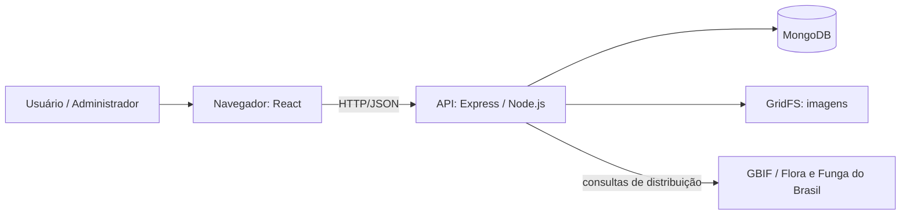

# Dossiê do projeto para a escrita do TCC

> Documento de apoio revisado em 06/11/2026. Reúne descrições que podem subsidiar o texto acadêmico, mas não substitui a validação dos autores, a revisão do orientador, as normas institucionais nem a consulta às fontes bibliográficas. Os testes automatizados descritos foram executados; build de produção, MongoDB real e integrações externas não foram verificados.

## 1. Identificação do projeto

**Nome:** Phytografia  
**Tipo:** aplicação web para consulta, organização e contribuição de informações botânicas.  
**Área técnica:** desenvolvimento de software, sistemas web e organização de informação botânica.  
**Público e contexto:** devem ser descritos pelos autores conforme o público realmente considerado no projeto e as atividades realizadas no TCC.

### Sugestão de título

**Phytografia: desenvolvimento de uma aplicação web para consulta e organização de informações botânicas**

Outras opções, conforme o foco efetivo do trabalho:

- **Phytografia: sistema web colaborativo para consulta de fichas botânicas**
- **Desenvolvimento de um catálogo digital de plantas com recursos de organização pessoal e moderação colaborativa**

Não inclua “avaliação de usabilidade”, “impacto educacional”, “validação por especialistas” ou expressões semelhantes no título sem ter realizado esse estudo.

## 2. Síntese do sistema

O Phytografia é uma aplicação web que reúne fichas de plantas em um catálogo pesquisável. As fichas podem conter identificação, descrição, características, necessidades de cultivo, imagens e informações de distribuição. A interface oferece busca textual, filtros, paginação e páginas de detalhes. Usuários autenticados podem organizar plantas em listas pessoais e encaminhar sugestões. Contas com papel administrativo podem criar e editar fichas, administrar opções de formulário e moderar sugestões.

O projeto foi implementado com React no cliente e Node.js/Express no servidor, com MongoDB para persistência. As imagens são armazenadas no GridFS do MongoDB e processadas com Sharp. Integrações com GBIF e Flora e Funga do Brasil são usadas por uma ferramenta administrativa para consultar e sugerir informações de distribuição; o código exige revisão humana antes de incorporar dados a uma ficha.

## 3. Problema, justificativa e objetivos — proposta para adaptação

Esta seção é uma proposta de redação. O problema científico ou social, a motivação local e a relevância precisam ser sustentados por bibliografia, contexto do curso e evidências reunidas pelos autores.

### Problema de pesquisa (formulação possível)

Como uma aplicação web pode apoiar a consulta, a organização e a atualização moderada de informações sobre plantas em fichas acessíveis por meio de um catálogo digital?

### Justificativa (elementos que o projeto permite discutir)

- A aplicação concentra dados de consulta em fichas organizadas por planta.
- Busca, filtros e paginação oferecem formas de explorar o catálogo.
- Listas pessoais apoiam a organização de registros por usuários autenticados.
- Sugestões moderadas permitem propor correções e novos registros sem conceder permissão de edição direta a qualquer conta.
- Integrações botânicas externas auxiliam administradores na consulta de distribuição geográfica.

Esses elementos descrevem funcionalidades implementadas; não comprovam, por si só, melhoria de aprendizagem, precisão taxonômica, qualidade percebida ou impacto na conservação.

### Objetivo geral (sugestão)

Desenvolver uma aplicação web para consultar, organizar e contribuir, sob moderação, com informações botânicas estruturadas em fichas de plantas.

### Objetivos específicos (ajustar ao que foi realizado)

1. Estruturar fichas botânicas com campos de identificação, características, cultivo, imagens e distribuição.
2. Implementar um catálogo com busca, filtros e paginação.
3. Desenvolver páginas de detalhes para apresentação das fichas.
4. Implementar autenticação e controle de acesso para diferenciar usuários e administradores.
5. Permitir organização pessoal de plantas em listas e envio de sugestões para moderação.
6. Integrar consultas a fontes externas para apoiar a sugestão de dados de distribuição.
7. Descrever e, caso tenha ocorrido, avaliar o sistema com participantes e critérios definidos no trabalho.

O objetivo 7 só deve ser mantido se houver procedimento de avaliação realmente executado; nesse caso, documentar protocolo, participantes, instrumentos, consentimento e resultados.

## 4. Escopo funcional observado no código

### Acesso público

- Página inicial com estatísticas e plantas em destaque.
- Catálogo com pesquisa por nome comum ou científico, filtros por características e navegação paginada.
- Ficha detalhada com conteúdo botânico, imagens, seções e distribuição quando disponível.
- Página informativa e formulário de contato.
- Opções de login local e início de autenticação social Google/GitHub.

### Usuário autenticado

- Criação e manutenção de listas pessoais de plantas.
- Inclusão e remoção de plantas das próprias listas.
- Envio e acompanhamento de sugestões de nova planta ou correção.

### Administrador

- Criação, edição, clonagem e remoção de fichas botânicas.
- Gerenciamento de usuários e opções de campos do formulário.
- Consulta e moderação de mensagens e sugestões.
- Consulta assistida de distribuição pelo GBIF e pela Flora e Funga do Brasil.

O backend aplica autorização nas operações administrativas. A interface também oculta ou redireciona telas por papel, mas a proteção efetiva precisa permanecer no servidor.

## 5. Arquitetura e tecnologias

O sistema segue uma arquitetura cliente-servidor. O frontend React consome uma API HTTP em Express; o servidor lê e grava dados no MongoDB. O Express também serve os arquivos estáticos do build do React quando configurado em produção.

| Camada | Tecnologias e responsabilidades observadas |
|---|---|
| Interface web | React 18, React Router, CSS, Bootstrap e componentes para catálogo, fichas, formulários, listas, mapas e moderação. |
| API | Node.js e Express 4; rotas separadas por domínio, como plantas, autenticação, usuários, listas, sugestões, mensagens e estatísticas. |
| Persistência | MongoDB, acessado pelo driver oficial; coleções sem esquema rígido declarado no código. Índices são sincronizados na inicialização. |
| Autenticação | JWT de acesso e refresh, hash de senha com bcrypt, sessões de refresh no MongoDB e papéis `User`/`ADM`. |
| Imagens | Upload via Multer, processamento/variantes via Sharp e armazenamento/entrega por GridFS. |
| Integrações | GBIF e serviço da Flora e Funga do Brasil para consultas administrativas de distribuição. |
| Operação e segurança | Variáveis de ambiente, Helmet/CSP, CORS, rate limits, compressão, logging estruturado e health check. |

### Diagrama simplificado

### Organização do repositório

- `mern-app-main-main/client/src`: aplicação React, páginas, componentes, utilitários de autenticação e apresentação.
- `mern-app-main-main/server/routes`: endpoints da API organizados por domínio.
- `mern-app-main-main/server/db/conn.js`: conexão, índices e opções iniciais.
- `mern-app-main-main/server/middleware`: autenticação/autorização e validações de entrada.
- `mern-app-main-main/server/data`: dados auxiliares, como mapeamentos geográficos.
- `mern-app-main-main/server/test`: testes automatizados de funções de paginação, CSP e OAuth.
- `mern-app-main-main/scripts`: scripts auxiliares de dados.

## 6. Dados e entidades

O MongoDB é utilizado com coleções. Os documentos são definidos no código das rotas, sem um esquema formal centralizado. Portanto, os itens abaixo são uma síntese conceitual e devem ser comparados com os dados reais do ambiente do projeto antes de aparecerem como modelo definitivo no TCC.

| Entidade/coleção | Uso observado |
|---|---|
| `plants` | Fichas botânicas, referências às opções de campos, textos, distribuição e metadados de imagem. |
| Coleções de opções (ex.: `origin`, `type`, `Family`, `Genero`) | Vocabulários usados por formulários e filtros; nomes permitidos são mantidos em uma allowlist. |
| `users` | Contas, credenciais com hash, papel e dados de provedor social quando aplicável. |
| `sessions` | Hash de refresh token, usuário associado, datas de criação/expiração e rotação. |
| `oauth_codes` | Hash de código OAuth temporário, usuário e expiração. |
| `userlists` / `userlist_items` | Listas pessoais e relações entre listas e plantas. |
| `favorites` | Estrutura legada usada na migração de favoritos para listas pessoais. |
| `suggestions` | Sugestões de novas plantas ou correções, com autor, status e dados da moderação. |
| `messages` | Mensagens enviadas pelo formulário de contato. |
| `fs.files` / `fs.chunks` | Armazenamento de arquivos de imagem no GridFS. |

Os status de sugestão presentes no código são `pendente`, `aprovada`, `rejeitada` e `concluida`. Para sugestões de nova planta, a publicação da ficha é feita pelo fluxo administrativo.

## 7. Fluxos importantes

### Consulta de catálogo

1. O cliente envia termo, filtros, página e tamanho da página para `GET /plant`.
2. O servidor monta os filtros e uma projeção enxuta para os cartões.
3. `paginateFind` aplica limite e ordenação no MongoDB.
4. A resposta contém `data` e metadados de paginação.
5. Ao abrir uma ficha, o cliente busca `GET /plant/:id` e resolve os valores de campos ligados a coleções de opções.

### Autenticação local e renovação

1. O usuário envia identificador e senha para login.
2. O servidor compara a senha com o hash bcrypt e emite access token e refresh token.
3. O hash do refresh token é salvo em `sessions`; o cliente usa `authFetch` para chamadas autenticadas e renovação. A sessão é consumida atomicamente no servidor para impedir que duas renovações concorrentes reutilizem o mesmo refresh token.
4. No logout, o cliente solicita revogação da sessão e remove os tokens locais.

**Observação documental:** o código atual de `POST /user/register` cria conta local diretamente e atribui papel `User`; não implementa confirmação por e-mail. O README afirma que há confirmação por SMTP, o que está divergente e precisa ser resolvido antes de descrever o fluxo no texto final.

### Login social

O backend inicia OAuth com Google ou GitHub, gera `state` aleatório, valida o retorno com cookie HttpOnly e, após validar dados do provedor, emite um código temporário de uso único. O cliente troca esse código por tokens em `POST /auth/exchange`. O código é armazenado como hash e possui expiração. Essa descrição corresponde ao código; funcionamento das credenciais e callbacks depende da configuração real de cada provedor.

### Sugestões e publicação

Usuários autenticados enviam sugestões. Administradores consultam e alteram status; sugestões de correção podem ser encerradas, enquanto uma sugestão de nova planta pode ser revisada e publicada como ficha. A publicação a partir da sugestão associa o novo registro à sugestão e atualiza seu status.

### Distribuição geográfica

As rotas administrativas consultam o GBIF e a Flora e Funga do Brasil. No GBIF, o código procura correspondência taxonômica, aplica um limiar mínimo de confiança de 95% e classifica registros geográficos conforme regras definidas no próprio projeto. A integração brasileira extrai estados, domínios e indicadores disponíveis na resposta. Essas respostas são **sugestões auxiliares**, não certificação taxonômica nem validação científica automática; a metodologia deve citar documentação das fontes e explicar as regras implementadas.

## 8. API — mapa resumido

As rotas abaixo foram localizadas no código. Consulte a implementação antes de publicar contratos detalhados; os exemplos não substituem uma especificação OpenAPI.

| Grupo | Exemplos | Acesso observado |
|---|---|---|
| Catálogo | `GET /plant`, `GET /plant/featured`, `GET /plant/:id` | Público. |
| Opções de campos | `GET /collections/options`, `GET /collections/:name`, `POST /collections/resolve` | Leitura pública; escrita exige administrador. |
| Fichas | `POST /plant/add`, `PUT /plant/:id`, `DELETE /plant/:id`, `GET /plant/:id/clone` | Administrador. |
| Usuários | `POST /user/login`, `POST /user/register`, `GET /user`, `PUT /update/:id` | Login/cadastro públicos; gestão administrativa protegida. |
| OAuth/sessões | `/auth/google`, `/auth/github`, `POST /auth/exchange`, `POST /auth/refresh`, `POST /auth/logout` | Público com validações específicas de fluxo. |
| Listas | `/userlists` e `/userlists/:id/...` | Usuário autenticado; dados limitados ao proprietário. |
| Sugestões | `/suggestions`, `/suggestions/minhas`, `/suggestions/:id` | Envio/autoconsulta autenticados; gestão administrativa protegida. |
| Mensagens | `POST /api/messages`, `GET /api/messages`, `DELETE /api/messages/:id` | Envio público com limite; leitura/remoção administrativa. |
| Outros | `GET /stats`, `GET /health`, `GET /sitemap.xml` | Público. |

As rotas de leitura de coleção estão paginadas, e o catálogo aceita filtros, busca, ordenação e limite de página. A configuração detalhada está em `server/pagination.js` e `server/routes/plant.js`.

## 9. Segurança, privacidade e confiabilidade

### Controles existentes

- Segredos e URI do banco exigidos por variáveis de ambiente.
- Senhas com bcrypt; tokens JWT verificados no servidor e papéis checados nas rotas administrativas.
- Refresh tokens persistidos como hash e com expiração/rotação.
- Estado OAuth validado e códigos de troca armazenados como hash, com uso único e prazo curto.
- Limitação de requisições em login, refresh, mensagens e sugestões.
- Helmet, CSP, CORS por allowlist e limites para corpo JSON. A política CORS detecta a origem própria em middleware que tem acesso à requisição; o callback `origin` do pacote CORS não recebe `req`.
- Filtro MIME e limite de 5 MB por arquivo no upload, além do processamento de imagens.
- Allowlist de coleções dinâmicas e paginação para reduzir consultas sem limite.
- Logs estruturados com redação de credenciais e endpoint `/health`.

### Pontos ainda não comprovados ou que merecem análise

- CORS e renovação concorrente foram corrigidos nesta revisão e têm testes; isso não equivale a uma auditoria completa de segurança.
- Refresh token fica em `localStorage`, acessível a JavaScript da origem.
- Cadastro por e-mail confirmado descrito no README não foi encontrado na implementação atual.
- O filtro do upload confia no MIME enviado pelo cliente; isso não comprova o formato real do conteúdo.
- A existência de controles no código não é evidência de teste de penetração, auditoria externa, conformidade legal ou ausência de vulnerabilidades.

Não afirmar conformidade com LGPD, segurança comprovada, alta disponibilidade, escalabilidade ou validação científica sem análises e evidências específicas.

## 10. Método de desenvolvimento — preencher com os fatos do TCC

O repositório permite descrever tecnologias e funcionalidades, mas não revela sozinho o processo de pesquisa e desenvolvimento. Registre somente o que realmente ocorreu. Um roteiro possível:

1. **Levantamento de requisitos:** quem definiu os campos botânicos, as funções e os perfis? Houve entrevistas, questionários, análise documental ou consulta a especialistas?
2. **Modelagem:** como os campos da ficha, as listas, usuários e sugestões foram definidos? Que decisões levaram ao MongoDB e à separação cliente-servidor?
3. **Implementação:** quais etapas foram feitas, por quem e em que período? Como foram integrados frontend, API, banco e fontes externas?
4. **Verificação:** quais testes foram executados? Em qual ambiente, com quais dados, critérios e resultados?
5. **Avaliação com pessoas (se ocorreu):** informar número e perfil dos participantes, tarefas, instrumento, consentimento, método de análise e limitações.

Não classificar automaticamente a metodologia como estudo de caso, pesquisa-ação ou experimento. A classificação deve refletir o protocolo aprovado e as atividades realmente realizadas.

## 11. Verificação e estado conhecido

O servidor usa `node:test` e atualmente tem 20 testes em oito arquivos. A cobertura inclui paginação, CSP/CORS, OAuth, autenticação/autorização, utilitários de dados botânicos e dois fluxos HTTP com Express e persistência simulada: cadastro/mensagens e concorrência no refresh token. O cliente usa Jest/CRA e tem seis testes de funções de domínio, cobrindo codificação de IDs, normalização textual e distribuição geográfica.

Execuções desta revisão: `npm test` no servidor (20 aprovados) e `CI=true npm test -- --watchAll=false --runInBand` no cliente (6 aprovados). Os testes de rota usam banco simulado; não foram executados build, testes contra MongoDB real, testes de navegador, testes manuais ou chamadas às integrações externas. `npm audit --omit=dev` após atualização de dependências reportou um alerta alto em Nodemailer, declarado no servidor mas não localizado em uso no código. Não registrar sucesso de build, desempenho ou funcionamento de produção sem evidência própria.

### Evidências que os autores podem reunir

- Capturas de tela das principais páginas e fluxos.
- Casos de teste, resultados e evidências de execução; ampliar cobertura das rotas ainda sem integração automatizada.
- Dicionário final de campos da ficha e exemplos de dados, sem expor dados pessoais.
- Diagrama ER/conceitual ou de coleções validado com o banco.
- Dados de avaliação, se houver, com método e consentimento documentados.
- Configuração de ambiente sem segredos e descrição do processo de deploy.
- Versões efetivamente usadas no desenvolvimento e data de referência.

## 12. Instalação e configuração técnica

O README do projeto indica Node.js 18 ou superior, MongoDB e instalação separada de dependências de servidor e cliente. O servidor requer `MONGODB_URI`, `JWT_SECRET` e `JWT_REFRESH_SECRET`; configurações de OAuth e origens dependem do ambiente. A interface usa `REACT_APP_API_URL`. O servidor pode ser iniciado com `npm run dev` na pasta `server`, e o cliente com `npm start` na pasta `client`; há também script de desenvolvimento na raiz `mern-app-main-main`.

As credenciais presentes em `.env.example` são exemplos, não valores reais. Não copiar segredos para o texto acadêmico, capturas de tela ou repositório.

## 13. Limitações e trabalhos futuros

Possíveis limitações observáveis ou que devem ser discutidas se confirmadas pelos autores:

- Conteúdo e cobertura do catálogo dependem dos registros efetivamente cadastrados; não há evidência no código de completude taxonômica.
- Sugestões automáticas de distribuição dependem da cobertura, nomenclatura e resposta dos serviços externos, além das regras locais de classificação.
- Parte do conteúdo depende de revisão e cadastro administrativo.
- Não foi identificada avaliação formal de usabilidade ou impacto educacional no repositório.
- A suíte automatizada agora cobre comportamentos unitários do servidor/cliente e dois fluxos HTTP com persistência simulada; permanecem lacunas em MongoDB real, upload, listas, moderação e navegador.
- A auditoria npm do servidor ainda reporta um alerta alto em Nodemailer; decidir entre atualizar a major ou remover a dependência se continuar sem uso.
- A confirmação de e-mail mencionada no README está divergente do cadastro implementado.

Como trabalhos futuros, podem ser considerados, após priorização: alinhar o fluxo de cadastro e a documentação; ampliar testes de integração para banco, upload, listas, moderação e navegador; formalizar validação e proveniência dos dados; avaliar o sistema com o público-alvo; resolver o alerta restante de dependência; e migrar a cadeia de build do frontend.

## 14. Estrutura sugerida para a monografia

1. **Introdução:** contexto botânico e informacional com fontes; problema, justificativa, objetivos e organização do texto.
2. **Referencial teórico:** bases botânicas/taxonômicas pertinentes, sistemas de informação, aplicações web e temas realmente usados no projeto.
3. **Materiais e métodos:** ambiente, processo de levantamento, tecnologias, arquitetura, modelagem, implementação e protocolo de verificação/avaliação.
4. **Desenvolvimento do sistema:** requisitos, componentes, fluxos, dados, integrações, segurança e decisões de projeto.
5. **Resultados:** funcionalidades implementadas e resultados medidos ou observados, acompanhados de evidências. Separar implementação de avaliação.
6. **Discussão:** alcance dos objetivos, comparação com literatura/trabalhos correlatos, limitações, riscos e implicações.
7. **Conclusão:** síntese do que foi realizado, resposta ao problema dentro das evidências, limitações e próximos passos.

## 15. Itens que os autores precisam completar

- Nomes dos autores, curso, instituição, campus, orientador e ano de defesa.
- Motivação original e contexto que levou à criação do Phytografia.
- Perfil do público-alvo e requisitos que foram levantados fora do código.
- Histórico de desenvolvimento, divisão de tarefas e decisões tomadas pela equipe.
- Fontes bibliográficas sobre botânica, taxonomia, distribuição, tecnologia e trabalhos correlatos.
- Proveniência, licenças, data de consulta e critérios de uso de dados/imagens.
- Ambiente e evidências de teste, implantação e eventual avaliação com usuários.
- Situação atual do cadastro: implementar confirmação de e-mail ou corrigir o README para refletir o comportamento desejado.
- Confirmação de que as funcionalidades descritas continuam disponíveis no ambiente apresentado na defesa.

## 16. Vocabulário consistente

- **Ficha botânica:** registro individual com informações sobre uma planta.
- **Catálogo:** conjunto navegável de fichas botânicas.
- **Coleção de opções:** conjunto de valores usados para preencher ou filtrar campos (por exemplo, origem ou tipo).
- **Lista pessoal:** agrupamento de plantas criado por um usuário.
- **Sugestão:** contribuição submetida por usuário para análise; não equivale automaticamente a dado aprovado.
- **Administrador (`ADM`):** papel autorizado a gerenciar fichas e moderar conteúdo.
- **Distribuição:** informação geográfica registrada ou sugerida para a planta; explicitar fonte e critérios sempre que apresentar resultados.

Evitar alternar entre “favoritos”, “coleções” e “listas” sem explicar a relação: a implementação atual organiza plantas em listas pessoais, e há código de migração de favoritos legados.

## 17. Fontes do próprio projeto consultadas

- `mern-app-main-main/README.md`
- `mern-app-main-main/server/server.js`
- `mern-app-main-main/server/routes/plant.js`
- `mern-app-main-main/server/routes/auth.js`
- `mern-app-main-main/server/routes/sessions.js`
- `mern-app-main-main/server/routes/user.js`
- `mern-app-main-main/server/routes/userLists.js`
- `mern-app-main-main/server/routes/suggestions.js`
- `mern-app-main-main/server/routes/messages.js`
- `mern-app-main-main/server/routes/stats.js`
- `mern-app-main-main/server/db/conn.js`
- `mern-app-main-main/server/pagination.js`
- `mern-app-main-main/server/middleware/auth.js`
- `mern-app-main-main/server/middleware/validate.js`
- `mern-app-main-main/server/oauthSecurity.js`
- `mern-app-main-main/server/test/`
- `mern-app-main-main/client/src/App.js`
- `mern-app-main-main/client/src/components/PlantList.js`
- `mern-app-main-main/client/src/components/PlantDetails.js`
- `mern-app-main-main/client/src/components/PlantFormWizard.js`
- `mern-app-main-main/client/src/components/Sugestao.js`
- `mern-app-main-main/client/src/components/SugestaoModeracao.js`
